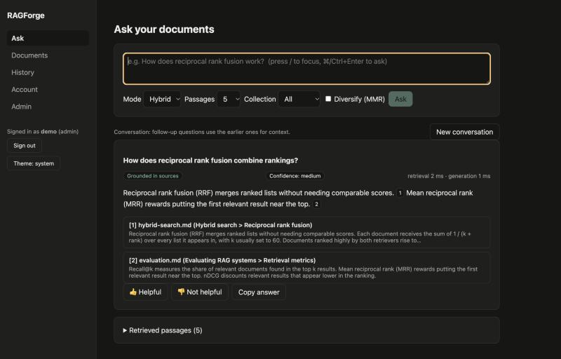
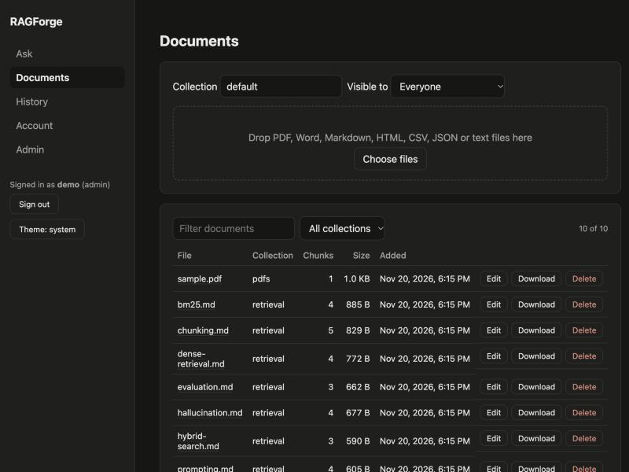
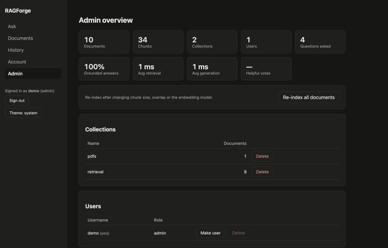

# RAGForge

[](https://github.com/vedantsajeevannair/ragforge/actions/workflows/ci.yml)

Retrieval-augmented question answering over your own documents. Upload PDFs, Markdown, HTML or
plain text, ask questions, and get answers that cite the passages they came from.

It runs fully offline by default (hashing embeddings plus an extractive answerer) and can be
switched to Claude, any OpenAI-compatible API, or a local Ollama model with one environment variable.



## Features

- **Ingestion**: PDF (with page numbers), Word, Markdown (heading-aware), HTML, CSV, JSON and
  text loaders; fixed, recursive, sentence and Markdown chunkers with overlap; repeated
  boilerplate removed; file contents checked against the extension.
- **Hybrid retrieval**: BM25 and dense vector search merged with reciprocal rank fusion,
  then a term-coverage re-ranker and optional MMR diversification.
- **Cited answers**: numbered context, `[n]` citations resolved to source snippets,
  invalid citations removed, a confidence score, and an abstain path when nothing relevant
  is found. Follow-up questions use earlier ones for context.
- **Streaming**: answers stream token by token over server-sent events.
- **Evaluation harness**: recall@k, MRR, nDCG, grounding rate and citation precision on a
  labelled question set, run in CI as a regression guard.
- **Multi-user API**: JWT auth with admin and user roles, private or shared documents,
  collections, per-user history, answer feedback, per-user rate limiting and background
  indexing for large files.
- **Operations**: Prometheus `/metrics`, `/ready` checks, JSON logs, re-indexing after
  settings changes, Docker Compose.
- **React UI**: streaming chat with citations and highlighted passages, document manager with
  drag-and-drop upload, history with CSV export, admin page for users and collections,
  dark mode.

<p>
  
  
</p>

## Architecture

```
            ┌──────────────┐   SSE / JSON   ┌───────────────────────────────────────────┐
  Browser ─▶│ React (Vite) │ ─────────────▶ │ FastAPI                                   │
            └──────────────┘                │  auth · documents · search · ask · stats  │
                                            │                                           │
                                            │  ingest ─▶ clean ─▶ chunk ─▶ embed        │
                                            │                         │                 │
                                            │            ┌────────────┴───────────┐     │
                                            │            ▼                        ▼     │
                                            │      vector store             BM25 index  │
                                            │            └─────── RRF fusion ─────┘     │
                                            │                       ▼                   │
                                            │            re-rank · MMR · prompt         │
                                            │                       ▼                   │
                                            │       LLM (extractive / Claude / OpenAI)  │
                                            │                       ▼                   │
                                            │            answer + resolved citations    │
                                            └───────────────────────────────────────────┘
                                                     SQLite: users, documents, history
```

## Quick start

```bash
# Backend
python -m venv .venv && source .venv/bin/activate
pip install -r backend/requirements-dev.txt
cd backend && uvicorn app.main:app --reload     # http://localhost:8000/docs

# Frontend (second terminal)
cd frontend && npm install && npm run dev       # http://localhost:5173
```

The first account you register becomes the admin.

Or run everything with Docker:

```bash
cp .env.example .env
docker compose up --build                       # http://localhost:8080
```

### Command line

```bash
cd backend
python -m app.cli index ../samples/corpus --collection docs
python -m app.cli ask "What value of k is usually used in RRF?"
```

## Using a real LLM

| Provider | Settings |
|---|---|
| Offline (default) | `RAGFORGE_LLM_PROVIDER=extractive` |
| Claude | `RAGFORGE_LLM_PROVIDER=anthropic`, `RAGFORGE_LLM_API_KEY=...` |
| OpenAI | `RAGFORGE_LLM_PROVIDER=openai`, `RAGFORGE_LLM_BASE_URL=https://api.openai.com/v1`, `RAGFORGE_LLM_MODEL=...`, `RAGFORGE_LLM_API_KEY=...` |
| Ollama | `RAGFORGE_LLM_PROVIDER=ollama`, `RAGFORGE_LLM_BASE_URL=http://localhost:11434/v1`, `RAGFORGE_LLM_MODEL=llama3.1` |

Embeddings can likewise use any OpenAI-compatible `/embeddings` endpoint with
`RAGFORGE_EMBEDDING_PROVIDER=http`. Changing the embedding model or dimension requires re-indexing.

## Evaluation

`samples/` holds a 9-document corpus about retrieval and 40 labelled questions, 14 of which are
reworded so they share few words with the answer.

```bash
cd backend && python -m app.eval.cli --corpus ../samples/corpus --dataset ../samples/eval.jsonl
```

Results with the offline hashing embedder, k = 3:

| config | hit@1 | hit@3 | MRR | nDCG@3 |
|---|---:|---:|---:|---:|
| BM25 | 0.925 | 0.975 | 0.950 | 0.957 |
| Dense (hashing) | 0.750 | 0.900 | 0.825 | 0.845 |
| Hybrid (RRF, dense weight 0.5) | 0.900 | 0.975 | 0.933 | 0.944 |
| Hybrid + re-rank + query expansion | 0.925 | 0.950 | 0.933 | 0.938 |
| Hybrid + re-rank + expansion + MMR | 0.750 | 0.825 | 0.787 | 0.797 |

Extractive answers on the same set: grounding rate 0.975, citation precision 0.829,
expected-phrase recall 0.806.

What this shows, honestly: with the offline hashing embedder, BM25 alone is as good as the full
pipeline on this corpus, because the dense ranker is weak on paraphrases. Hybrid search is
built for a real embedding model (`RAGFORGE_EMBEDDING_PROVIDER=http`), where the dense side
carries its weight. The corpus is small and on one topic, so use these numbers to compare
changes, not to predict accuracy on your documents. See [docs/evaluation.md](docs/evaluation.md)
for the experiments behind the defaults.

## API

| Method | Path | Description |
|---|---|---|
| POST | `/auth/register`, `/auth/login` | Get a bearer token |
| GET | `/auth/me` | Current user |
| POST | `/documents` | Upload a file (`file`, `collection`, `visibility`); 202 + job id if large |
| GET | `/documents?q=&collection=&limit=&offset=` | List visible documents |
| GET | `/documents/{id}`, `/documents/{id}/chunks`, `/documents/{id}/download` | One document |
| PATCH / DELETE | `/documents/{id}` | Edit or delete (owner or admin) |
| POST | `/documents/reindex` | Re-chunk everything with current settings (admin) |
| DELETE | `/documents/collections/{name}` | Delete a collection (admin) |
| GET | `/jobs/{id}` | Background indexing status |
| POST | `/search` | Ranked passages |
| POST | `/ask` | Answer with citations |
| POST | `/ask/stream` | Same, as server-sent events |
| GET | `/history` · POST `/history/{id}/feedback` | Past questions and ratings |
| GET | `/collections`, `/config`, `/stats` | Metadata (stats is admin-only) |
| GET / PATCH / DELETE | `/users`, `/users/{id}` | User management (admin) |
| POST | `/auth/password` | Change your password |
| GET | `/health`, `/ready`, `/metrics` | Liveness, readiness, Prometheus metrics |

Full interactive docs at `/docs` when the server is running.

## Development

```bash
cd backend && ruff check app tests && pytest -q
cd frontend && npm run typecheck && npm test
```

## License

MIT
